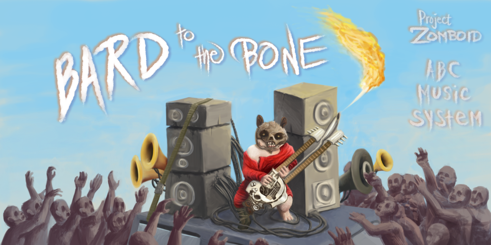

 

#### [**Bard-To-The-Bone**](https://steamcommunity.com/sharedfiles/filedetails/?id=3484029638) is a Project Zomboid mod that lets players perform music using ABC notation, with support for all vanilla instruments and custom ones. Click here to visit the [Steam Workshop Page](https://steamcommunity.com/sharedfiles/filedetails/?id=3484029638).

### Disclaimers:
1. I am not a musically inclined person, so there's probably obvious mistakes made / issues with this system. If you're expecting a high fidelity experience this mod is not for you.
2. How Project Zomboid handles threads, framerates, and ticks can impact timings and playback may suffer because of this.
  

### What is ABC Notation?

[ABC notation](https://en.wikipedia.org/wiki/ABC_notation) is a simple, text-based music format using letters and numbers to represent notes, rhythms, and other musical elements. It's designed to easily write and share music, especially melodies, without needing specialized music software.

**Notable Games that use ABC Notation Music Systems:**
- The Lord of the Rings Online (LOTRO)
- Starbound
- UnReal World
- Wurm Online
- Spacestation 13
  

### [Bard to The Bone Song Library](./Contents/mods/BardToTheBone/common/media/SONGLIBRARY_README.MD)
**Collection of 780+ songs ready to be played in-game.** 
*Modified from the [Starbound Song Pack](https://github.com/luxx/sbsp)*
  

### How to Add Your Own Songs (Step by Step)

**1. Get a song**
- **Already in ABC?** Copy the text from a site like [abcnotation.com](https://abcnotation.com/) and skip to step 3.
- **Have a MIDI file?** Find one on a site like [freemidi.org](https://freemidi.org/), or use your own, and go to step 2.

**2. Convert the MIDI to ABC**
- Open the [Bard to the Bone MIDI to ABC Converter](https://chuckleberry-finn.github.io/Bard-To-The-Bone/), drop the MIDI in and press **Copy** (or **Download**). 
Every instrument becomes its own part (`V:1`, `V:2`, ...) so a band can each pick one, and drums go to the drum kit. It runs in your browser; nothing is uploaded.

**3. Check it sounds right (optional)**
- Paste the ABC into the [Online ABC Player and Editor](https://abc.rectanglered.com/) and press play. Fix anything odd here before taking it in-game. 
Songs from the converter are written for this mod and may not play right in other ABC players; try those in-game instead.

**4. Put it in the game** (either way works)
- **In-game:** equip an instrument, open its song window, click **abc** at the start of the button row to open the editor, press **New**, paste the ABC and press **Save**.
- **As a file:** save the text as a `.txt` or `.abc` file in `Zomboid/Lua/BardToTheBoneSongLibrary/` 
(on Windows: `C:/Users/<you>/Zomboid/Lua/BardToTheBoneSongLibrary/`), then press **Reload Songs** in the song window's gear menu.

**5. Play it**
- Pick the song from the list and press **Play**.
- If it has several parts, the voice button next to Play lets you pick one. Leave it on **All** to play the whole song.
- In multiplayer, start the same song as someone nearby and you'll join in, in time.

**If something's off**
- **Too fast or too slow:** change or add the `Q:` line, e.g. `Q:1/4=120` (bigger is faster).
- **Wrong name in the list:** the list shows `C:` (artist) and `T:` (title) as "Artist - Title".
- **Nothing plays:** make sure the header has `X:`, `T:` and `K:` lines and the notes come after `K:`.
- **A big pile of notes on one instrument:** that ABC had every instrument merged; convert the MIDI again with the [converter](https://chuckleberry-finn.github.io/Bard-To-The-Bone/) set to **Per instrument**.

The in-game **Song Guide** button (gear menu) opens this page.
  

**Useful Links:**

**[Online ABC Player and Editor](https://abc.rectanglered.com/)** 
An online interface for playing and editing ABC notations.

**[onlinesequencer](https://onlinesequencer.net/sequences)** 
Online MIDI sequencer/player for creating ones own songs, also hosts user generated content.

**[freemidi.org](https://freemidi.org/)** 
A collection of MIDIs you can use an ABC converter on.

**[Bard to the Bone MIDI to ABC Converter](https://chuckleberry-finn.github.io/Bard-To-The-Bone/)** 
Converts MIDIs to ABC made for this mod: one part per instrument, drums kept for the drum kit, timing checked against the in-game player.

**[Midi2ABC.exe](https://github.com/Chuckleberry-Finn/Bard-To-The-Bone/releases/tag/Midi2ABC)** 
Older offline converter, supports selecting file(s) and drag and drop. 
**Note: This uses a modified easyABC script, and produces everything in a single track.** 
*All files are generated in folder alongside the exe.*

**[easyABC converter](https://github.com/jwdj/EasyABC)** 
Great program for local conversions, 
**Note: by default it produces songs in multiple voices/performers** which requires splitting the tracks up manually.

**[abcnotation.com](https://abcnotation.com/)** 
A great website that features all things ABC-notation, includes: thousands of public-domain songs, links to various related programs and information.

  

**Credits:**
- Music Note Sounds - Generated using fluidSynth & FluidR3_GM.sf2, [SS13-TG](https://github.com/tgstation/tgstation)
- Default Songs - [abcnotation](https://abcnotation.com) & [@duVillage](https://www.youtube.com/@duVillage)
- Song Library - [Luxx's Starbound Song Pack](https://github.com/luxx/sbsp)
- CrystalChris - Animations
- [Shurutsue](https://github.com/Shurutsue) for helping with troubleshooting/research.
###
